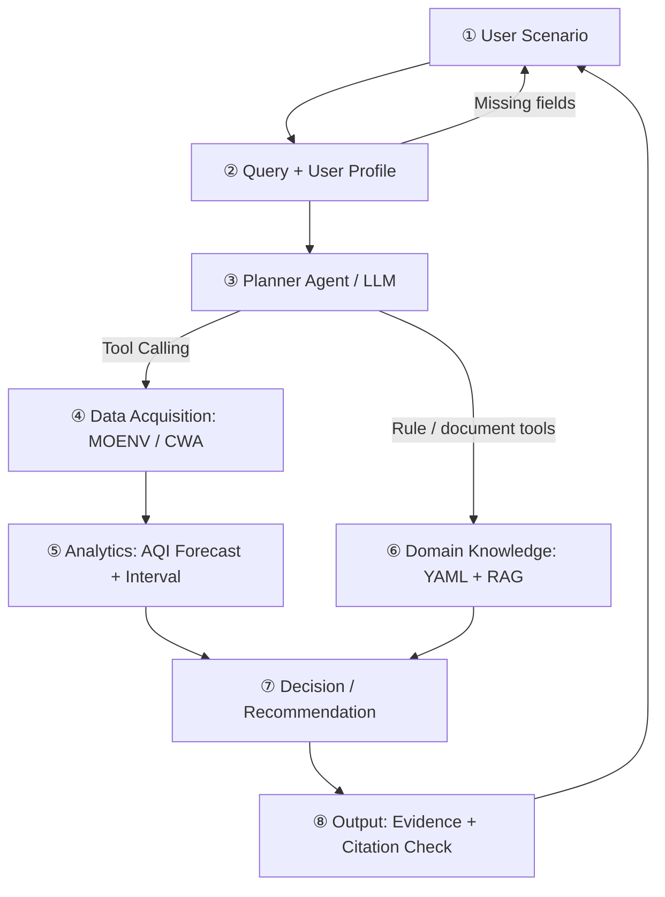

# AirWise — 空氣品質健康顧問 AI Agent

> **從 AQI 數字到有依據的個人化戶外活動決策**  
> AIoT 期末專題｜第 15 組｜Proposal / Spec-Driven Development 階段

**專題成員：** 葉冠廷、陳泳碩、張嘉晏、張家誠  
**專題 Repository：** https://github.com/L34F-yeah/AIoT_Team15_AirWise  
**文件版本：** Proposal Refactor（2026-11-12）

> **狀態聲明**：本 README 根據已提供的 `DESIGN.md`、Proposal Document v1.1 與 Proposal PPT v1.1 整理。設計文件顯示多數程式模組仍為「骨架／未開始」，且實驗結果仍待驗證；因此以下架構、功能與執行方式屬**規劃與驗收目標**，不代表目前已能完整運行。本次未檢查線上 GitHub 程式碼，也沒有執行系統測試。

## 1. Project Overview

一般空品 App 常顯示「AQI 112，橘色」，但使用者真正關心的是：「孩子有氣喘，明天早上 7 點可以在公園跑 30 分鐘嗎？要不要換時間？」AirWise 旨在將**位置、時段、族群與活動強度**轉為可查證的空氣品質行動建議。

**核心原則：LLM 負責理解問題及表達答案；資料工具、預測模型與官方規則負責數據與決策。** 不允許 LLM 直接虛構 AQI、污染物數值或規則。

### Expected Capabilities（規劃功能）

- 解析自然語言中的地點、時間、活動與強度，必要時主動詢問缺失欄位。
- 透過環境部開放資料取得即時 AQI，結合中央氣象署天氣預報。
- 預測未來 1–24 小時 AQI 並呈現預測不確定性。
- 結合臺灣 AQI 六級、族群與活動強度，提供符合官方健康指引的建議。
- 優先提出換時段、降低活動強度或移至室內等替代做法。
- 回覆附上測站、資料時間、規則 ID、文件出處，引用不合格改用模板回答。

## 2. Research Motivation & Gap

既有應用往往只提供當下的污染指標；空品預測研究著重數值準確度；LLM 空品介面則著重檢索與摘要。AirWise 的研究問題是：**如何在單一、可驗證的 Agent 工作流程中整合未來空品預測、個人敏感度、活動情境、臺灣官方規則與可追溯的自然語言解釋？**

提案中的背景數據與研究論文引用需在最終提交前再次逐一核對原始來源。詳見 [`docs/INTRODUCTION.md`](docs/INTRODUCTION.md) 與 [`docs/RELATED_WORK.md`](docs/RELATED_WORK.md)。

## 3. Architecture（八模組）



| Module | Planning / Ownership | 實作對應（依 DESIGN.md） |
|---|---|---|
| ② Query + Profile | 使用者情境與敏感族群 | `src/airwise/profile.py` |
| ③ Planner | 意圖解析、Tool Calling、反問 | `src/airwise/agent.py` |
| ④ Data | 取得即時 AQI、天氣與歷史資料 | `src/airwise/tools/aqi.py`、`weather.py` |
| ⑤ Analytics | Persistence / 前日同期 / XGBoost，LSTM 為擴充 | `src/airwise/forecast/` |
| ⑥ Domain | `AQI × 族群 × 活動強度` 規則、RAG 引用 | `knowledge/aqi_rules.yaml`、`src/airwise/rules/`、`rag/` |
| ⑦ Decision | 預防原則與替代時段 | `src/airwise/decision.py` |
| ⑧ Output | 證據輸出、引用檢查、回答模板 | `src/airwise/output.py`、`app/main.py` |

完整需求 FR1–FR9、架構、資料流與實作映射見 [`DESIGN.md`](DESIGN.md)。

## 4. Data Sources & Models

| 資料／方法 | 主要用途 | 狀態 |
|---|---|---|
| 環境部 AQI API `aqx_p_432` | 即時測站與污染物資料 | 設計指定，需申請／確認 API |
| 環境部歷史空品資料 | 臺中測站 2023–2024 訓練，2025 測試 | 資料集待取得與核對 |
| 中央氣象署臺中預報 `F-D0047-075` | 風速、濕度、降雨等特徵 | 設計指定，需驗證欄位與更新率 |
| 官方 AQI 健康影響與活動建議 | 規則表及文件引用 | 規則骨架，須逐條對照原文 |
| Persistence、前日同時段 | 預測 Baselines | 待評測 |
| XGBoost | 主要 1–24 小時預測模型 | 待訓練 |
| LSTM | 擴充對照模型 | Optional |
| OpenAI function calling | 意圖解析與答案語言化 | API 整合規劃中 |

## 5. Repository Layout（目標結構，不代表皆已存在）

```text
AIoT_Team15_AirWise/
├── README.md
├── DESIGN.md
├── docs/
│   ├── INTRODUCTION.md
│   └── RELATED_WORK.md
├── openspec/
│   └── changes/refactor-airwise-proposal/
│       ├── proposal.md
│       ├── design.md
│       ├── tasks.md
│       └── specs/air-quality-advice/spec.md
├── requirements.txt          # 待與實際程式同步
├── .env.example              # 待與實際 API 參數同步
├── data/                     # 資料下載／說明（勿提交大型原始檔）
├── knowledge/                # AQI 規則與官方資料
├── src/airwise/              # Agent、工具、預測、規則、RAG
├── eval/                     # 情境題、指標與實驗結果
└── app/                      # Web/Streamlit 介面（規劃）
```

## 6. Installation & How to Run

**目前上傳資料只有設計與提案文件，沒有可驗證的程式碼、`requirements.txt` 或 `.env.example`。因此不能保證以下執行流程已可用。** 完成程式實作後，應依實際檔案補上可重現步驟：

1. Clone 專題 GitHub，確認 Python 版本與 `requirements.txt`。
2. 建立虛擬環境、安裝依賴，複製 `.env.example` 並設定 `OPENAI_API_KEY`、`OPENAI_MODEL` 及環境部／氣象署 API 所需憑證；**不得提交 `.env` 或金鑰**。
3. 使用 `data/download.py`（若已實作）準備資料，校驗資料區間與測站名稱。
4. 待 `app/main.py` 與相依套件完成後，將實際測試通過的啟動命令寫在此節。
5. 使用 `eval/` 的評測程式重現 E1–E3，並保存模型版本、測試切分與結果。

**現階段可直接執行的文件流程：OpenSpec 規格規劃。**

```bash
npm install -g @fission-ai/openspec@latest
# 進入你自己的 AirWise 專案根目錄
openspec init
```

於支援 OpenSpec 的 AI coding assistant 聊天欄輸入（並非 shell 命令）：

```text
/opsx:propose refactor-airwise-proposal
```

已附 `openspec/changes/refactor-airwise-proposal/` 的**人工整理初稿**供對照；請在實際專案完成 `openspec init` 後檢查是否符合該版工具格式，不應宣稱已通過 OpenSpec CLI 驗證。依序檢視 `proposal.md` → `spec.md` → `design.md` → `tasks.md`，實作後再使用 verify/archive 工作流程。

官方 OpenSpec 文件：https://openspec.dev/ 

## 7. Experimental Design（計畫，無實測成果）

| Experiment | Dataset / Comparison | Metrics |
|---|---|---|
| E1 AQI Prediction | 臺中市測站，2023–2024 訓練、2025 測試；Persistence、前日同期、XGBoost | MAE、RMSE、Macro-F1，1/6/12/24 小時 |
| E2 Recommendation Quality | 50 題在地情境（含 10 題缺資訊／失敗案例）；純 LLM、LLM+資料、AirWise | 官方指引一致率、幻覺率、引用正確率、反問正確率 |
| E3 User Perception | ≥20 份線上問卷、5 情境，對照環境即時通截圖 | 偏好比例、決策信心、資訊清楚度 |
| Ablation | 移除預測、規則、RAG、引用檢查 | E2 指標變化 |

E2 原提案規劃兩位標註者獨立評分並計算 Cohen's κ。問卷屬初步偏好研究，不代表真實使用效益，也不應預先宣稱統計顯著。

## 8. Safety, Limitations & Status

- 預測區間跨 AQI 等級且對象為敏感族群時，規劃採保守等級；這是設計決策，需再檢驗實際效益。
- 測站不等於使用者所在位置；遠距、地形及工業區因素可能造成代表性偏差。
- 官方規則須記錄來源、版本與適用條件；回答應附資料時間與免責說明。
- 本系統提供公共空品資訊與活動規劃輔助，**不提供醫療診斷，不能取代醫囑或緊急警示**。
- 實作階段：多個模組為骨架，預測與輸出尚未完成（以提供的 DESIGN v0.1 為準）。

## 9. Proposal Deliverables & Documentation

- [`DESIGN.md`](DESIGN.md) — Problem → Requirements → Architecture → Data → Algorithm → Implementation Mapping。
- [`docs/INTRODUCTION.md`](docs/INTRODUCTION.md) — Refactored A–F Introduction / Research Gap / Contributions。
- [`docs/RELATED_WORK.md`](docs/RELATED_WORK.md) — AI + Domain Literature / Article Summary Table / Gap。
- `openspec/changes/refactor-airwise-proposal/` — 規格驅動開發草稿與驗收情境。
- 原始 Proposal Document v1.1 與 PPT v1.1 — 研究背景、圖表、評估計畫與參考文獻原始依據。

## 10. Attribution & Reference Policy

本文件忠實整理團隊提供之 2026-10-28 Proposal 與 DESIGN.md；未獨立驗證所有參考文獻與新聞數值。正式提交時，請以提案末尾 References 為線索，逐筆核對原論文、官方頁面、日期、DOI 與網址；不得將「預期成果」寫成「已測得結果」。
